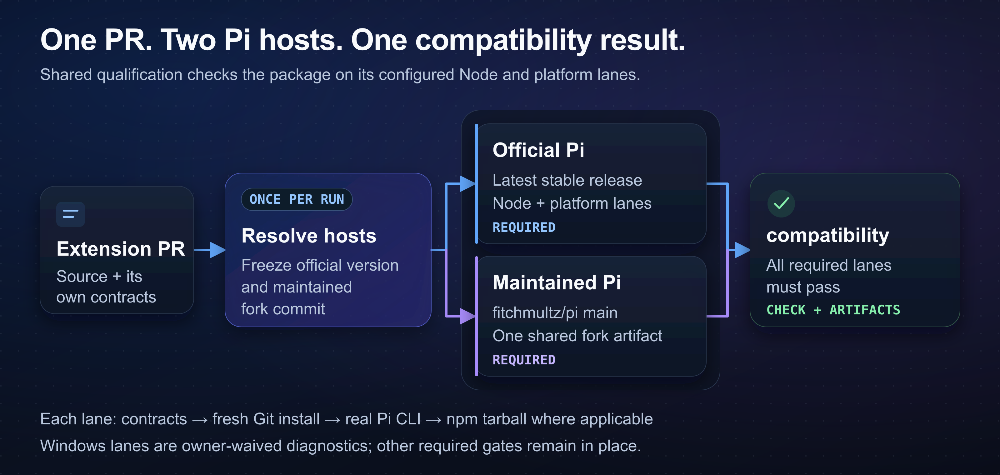

# Shared Pi automation

This repository provides GitHub Actions checks, a shared dependency-security policy, and npm release automation for Mitch's Pi packages. Connect your package repository with the [setup guide](docs/integration.md).



## Use the shared automation

Each package repository keeps its source, lockfile, and `check:compat` command.

1. Add the compatibility workflow to your repository. Pin the workflow and `automation-ref` to the same reviewed commit.
2. Enable GitHub Dependabot alerts and security updates using the [setup guide](docs/integration.md#security-updates). Verify security updates are enabled and not paused.
3. Add this preset to your repository's `renovate.json` to disable Renovate:

   ```json
   {
     "$schema": "https://docs.renovatebot.com/renovate-schema.json",
     "extends": ["github>fitchmultz/.github:pi-extensions"]
   }
   ```

Open a PR. Check its compatibility result.

GitHub Dependabot handles security-fix PRs, including transitive lockfile fixes. Renovate is disabled; there is no scheduled version-update configuration. Ordinary dependency and reviewed workflow-pin upgrades are manual. Security PRs still require compatibility checks and maintainer review; automatic merge is not enabled.

## Package checks

Normal extension PRs test the latest stable official Pi and maintained `fitchmultz/pi` main. Each run resolves the official version and fork commit once, and every job reuses them.

Each extension lane runs package contracts, installs a fresh Git checkout with production dependencies, and loads extensions and themes through the real Pi CLI. Packages released to npm also test a tarball install and compare its tools, commands, and providers with the Git install. Skills packages run their resource checks instead.

The checks use empty profiles without provider credentials. Keep each package's separate browser, desktop, and paid-provider release checks.

**Native Windows is best-effort.** Normal PRs, releases and the daily canary require Linux/macOS, not full Windows qualification. A small Windows environment smoke check remains nonblocking; deeper Windows suites are explicit opt-in diagnostics. Their real failures remain unresolved, and a passing required check does not certify Windows support. The [qualification reference](docs/qualification.md) records the policy, opt-in, host preparation, lane settings and command budgets.

## Results and failures

Read the compatibility check in GitHub Actions. Download its `qualification-*` artifacts to find the tested source, exact hosts, failed phase, and consumer output. Missing evidence, cancellation, or a failed required lane prevents a successful result.

The Pi release canary checks repository default branches and published npm versions. It updates one issue per affected repository. When a repository leaves `fleet.json`, a canary running on the automation repository's default branch closes its automation-owned issues as not planned, preserving the last evidence without claiming compatibility passed. Candidate-branch runs never retire trackers. Set `PI_COMPATIBILITY_ENABLED=true` in this repository's Actions variables to enable it.

The canary reports failures without publishing packages or changing Pi installations. Fix failures through the affected repository's normal PR process.

## Automatic npm releases

Release only the package names in [fleet.json](fleet.json). Each main merge is queued for an automatic patch version, lockfile update, and release notes. Pi Durable addresses failing checks and review feedback, including Cursor's complete reports, before the version PR merges.

The release workflow verifies one candidate tarball on both Pi hosts, then publishes the same version and source to npm and GitHub. Repository-specific release qualification still applies; the shared offline checks do not replace live or platform-specific gates.

An unfinished release is reconciled without overwriting published bytes. Follow the [npm release guide](docs/npm-releases.md) for setup, package-specific prerequisites, and recovery.

## Contribute

Use Node 24. Run the unit tests from a checkout:

```sh
npm test
```

Follow the [development guide](docs/development.md) for dependency setup, native CLI tests, Renovate validation, and local qualification.

This repository's CI runs the full fleet for shared runtime/workflow changes and manual dispatches. Docs, policy and proven validator-only changes keep the local checks without requalifying every package; see [CI scope](docs/development.md#ci-scope).
